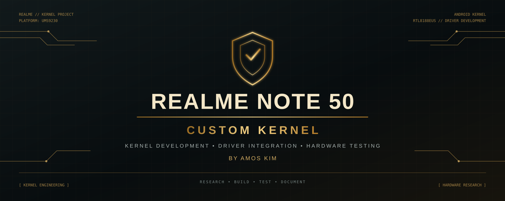

<div align="center">



# Realme Note 50 Custom Kernel

### Android Kernel Research • Driver Development • Hardware Integration

**An experimental kernel engineering project for the Realme Note 50 (RMX3834).**

[Documentation Wiki](https://github.com/amoskim318/Realme-Note-50-Custom-Kernel/wiki) · [Download Kernel Module](https://github.com/amoskim318/Realme-Note-50-Custom-Kernel/raw/refs/heads/main/releases/RTL8188EUS-Realme-Note-50-Magisk-v1.0.2.zip) · [Report an Issue](https://github.com/amoskim318/Realme-Note-50-Custom-Kernel/issues)

</div>

---

## About the Project

This project documents the investigation, development, modification, and testing of the Android Linux kernel on the **Realme Note 50**.

The main engineering objective is to extend the device's external hardware compatibility through Linux kernel driver integration.

A major achievement is the integration and testing of the **Realtek RTL8188EUS USB Wi-Fi adapter**, including successful kernel module loading, wireless interface creation, monitor-mode operation, and packet capture.

The repository preserves the source code, compatibility patches, compiled module, testing evidence, and development history.

## Device and Platform

| Component | Specification |
|---|---|
| Device | Realme Note 50 |
| Model | RMX3834 |
| Operating System | Android 15 |
| SoC | Unisoc UMS9230 |
| Running Kernel | Linux 5.15.178 |
| Architecture | ARM64 (AArch64) |
| External Wi-Fi Adapter | Realtek RTL8188EUS |
| USB Vendor/Product ID | `0bda:8179` |

## Available Releases

### Recommended: Magisk Installation

**Realme Note 50 RTL8188EUS Driver — Magisk v1.0.2**

- Device: Realme Note 50 (RMX3834)
- Architecture: ARM64
- Installation: Magisk app → Modules → Install from storage
- Includes the kernel module, metadata, and boot service.

**[Download Magisk ZIP v1.0.2](https://github.com/amoskim318/Realme-Note-50-Custom-Kernel/raw/refs/heads/main/releases/RTL8188EUS-Realme-Note-50-Magisk-v1.0.2.zip)**

SHA-256:

```text
cfa86b6b4cffc8a3fe3d96459044c69b65772a987b206b7632b1d9a70744d6cb
```

### Standalone Kernel Module

**[Download 8188eu.ko](https://github.com/amoskim318/Realme-Note-50-Custom-Kernel/raw/refs/heads/main/releases/8188eu.ko)**

SHA-256:

```text
9da3fb217643542ee3d1c2bc36cddc6c3dc5445c20b2ee24aafb125f7d468b73
```

**Important:** The .ko file is a loadable kernel module, not a complete kernel image, boot image, recovery image, or custom ROM. It requires root access and a compatible kernel environment.

## Development Areas

- Kernel source and vendor configuration research
- RTL8188EUS driver integration and compatibility
- ARM64 kernel module compilation
- Android and Magisk module installation
- Monitor-mode and packet-capture testing
- USB disconnect crash investigation

## Testing Results

| Test | Result |
|---|---|
| Module compilation and loading | Successful |
| USB adapter recognition | Successful |
| Wireless interface creation | Successful |
| Monitor mode | Successful |
| Passive packet capture | Successful |
| USB disconnect stability | Under investigation |

## Known Issue

Physically disconnecting the USB adapter has triggered a kernel crash and device reboot. The cause remains under investigation.

## Repository Structure

| Directory | Purpose |
|---|---|
| `driver-source/` | Driver source |
| `patches/` | Compatibility modifications |
| `releases/` | Kernel module and checksums |
| `evidence/` | Screenshots, logs and videos |
| `tests/` | Testing scripts |
| `poc/` | Proof-of-concept experiments |
| `kernel-source/` | Kernel source references |

## Documentation

See the [Project Wiki](https://github.com/amoskim318/Realme-Note-50-Custom-Kernel/wiki) for detailed engineering documentation.

## Disclaimer

This is an independent experimental project, not an official Realme product. Kernel modifications can cause instability, crashes, data loss or boot failure. Use at your own risk. Wireless security testing must only be performed on networks and devices you are authorized to test.

---

<div align="center">

**Developed and documented by Amos Kimunya**

*Research • Build • Test • Document*

</div>

---

## Connect with the Developer

**Developer:** [Amos Kimunya](https://github.com/amoskim318)

- [Follow me on GitHub](https://github.com/amoskim318)
- [Star the Realme Note 50 Custom Kernel repository](https://github.com/amoskim318/Realme-Note-50-Custom-Kernel)

If this project helps you, please consider following my GitHub profile and starring the repository. Thank you for your support!
